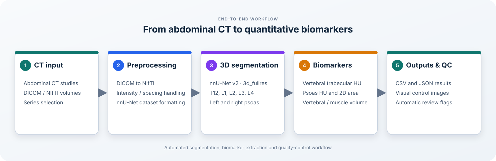

# Medical CT Biomarker Extraction

**Automated 3D segmentation and biomarker extraction from abdominal CT scans using nnU-Net v2.**

This project was developed as a final-year Data Science project at the Universitat Politècnica de València. It explores an end-to-end workflow to identify vertebral and psoas muscle structures in abdominal CT scans and extract quantitative biomarkers relevant to body-composition assessment in liver transplant candidates.

The final model performs 3D multi-class segmentation of five vertebral levels (T12-L4) and both psoas muscles. Its predictions are then processed to calculate bone and muscle measurements, generate structured outputs and flag cases that may require manual review.

## Pipeline overview



The workflow covers:

1. CT study preparation and DICOM-to-NIfTI conversion.
2. Dataset construction using anatomical masks derived from TotalSegmentator.
3. 3D multi-class segmentation with nnU-Net v2.
4. Anatomical post-processing and biomarker extraction.
5. Quality checks and export of CSV, JSON and visual control outputs.

## Segmented structures

The model predicts seven anatomical classes:

| Label | Structure |
|---:|---|
| 1 | T12 vertebra |
| 2 | L1 vertebra |
| 3 | L2 vertebra |
| 4 | L3 vertebra |
| 5 | L4 vertebra |
| 6 | Left psoas muscle |
| 7 | Right psoas muscle |

Background is encoded as label 0.

## Extracted biomarkers

### Vertebral analysis
- Trabecular attenuation in Hounsfield Units (HU).
- Vertebral volume.
- Anatomical level selection with fallback logic when the preferred level is unavailable or unsuitable.

### Psoas analysis
- Right and left cross-sectional area (cm²).
- Mean attenuation (HU) for each side.
- Right and left muscle volume (cm³).
- Anatomical level selection and bilateral measurements.

### Quality control
The post-processing stage checks whether measurements are anatomically plausible and records cases that may need review. These flags are intended to support quality control; they are not clinical diagnoses.

## Model and validation results

The final model used the **nnU-Net v2 3D full-resolution configuration** and was trained for 1,000 epochs. The project report presents the following internal validation results:

| Structure | Dice / DSC | IoU |
|---|---:|---:|
| T12 | 0.922 | 0.898 |
| L1 | 0.944 | 0.926 |
| L2 | 0.934 | 0.912 |
| L3 | 0.927 | 0.906 |
| L4 | 0.927 | 0.905 |
| Left psoas | 0.852 | 0.781 |
| Right psoas | 0.855 | 0.792 |
| **Global mean** | **0.909** | **0.874** |

The vertebral classes achieved higher overlap scores than the psoas muscles. These values come from the internal validation described in the project report and should not be interpreted as external or clinical validation.

An additional exploratory analysis compared total psoas cross-sectional area (2D) with bilateral psoas volume (3D). It reported a Pearson correlation of **r = 0.744 (p < 0.001)**. This analysis explores consistency between two measurements; it does not establish clinical validity.

## Example outputs

The repository includes small, synthetic examples of the exported biomarker table and debug metadata:

- [Example biomarker CSV](examples/outputs/example_biomarkers.csv)
- [Example debug JSON](examples/outputs/example_debug.json)

The sample records are illustrative and do not contain patient data.

## Technologies

- Python
- PyTorch
- nnU-Net v2
- NumPy and SciPy
- pandas
- NiBabel
- pydicom and dicom2nifti
- scikit-image
- Matplotlib
- PyYAML

## Repository structure

```text
medical-ct-biomarker-extraction/
├── assets/
│   └── pipeline_overview.svg
├── configs/
│   └── paths.example.yaml
├── docs/
│   └── pipeline_overview.md
├── examples/
│   └── outputs/
│       ├── example_biomarkers.csv
│       └── example_debug.json
├── src/
│   ├── data_preparation/
│   ├── inference/
│   └── clinical_analysis/
├── requirements.txt
├── LICENSE
└── README.md
```

## Setup and reproducibility

Create a Python environment and install the listed dependencies:

```bash
python -m venv .venv
```

Activate the environment, then run:

```bash
pip install -r requirements.txt
```

A compatible PyTorch/CUDA setup and the nnU-Net v2 environment are required for model training and inference. The raw CT volumes, reference masks and trained model weights are not included in this repository.

**Important:** this repository is a research-project snapshot rather than a turnkey package. Several scripts still contain machine-specific Windows paths. The `configs/paths.example.yaml` file is a configuration template, but it is not yet wired into every script. The dataset preparation scripts also need their dataset IDs and output paths aligned before running the complete workflow on another machine. Review and adapt those settings before execution.

## Data privacy and intended use

No raw clinical CT scans, patient-level clinical records or trained weights are distributed in this repository. Only synthetic example outputs and project code are included.

This project is intended for educational and research purposes. It is not a medical device and must not be used to make clinical decisions.

## Author

**Carlos Soriano Adam**  
Data Science Graduate · Universitat Politècnica de València
